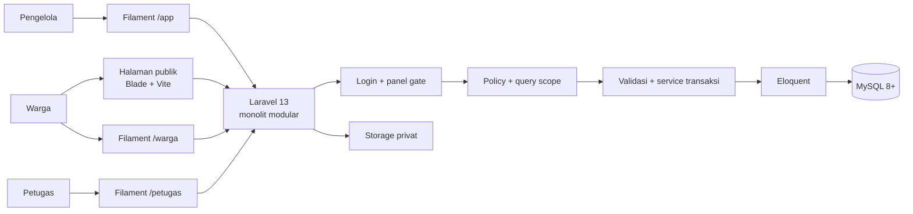

# Arsitektur Hijauku - Rev 1

**Status:** Baseline arsitektur untuk starter Sprint 0.
**Berlaku:** Scope aktif 15 modul, lima anggota, Laravel 13 + Filament 5.
**Pemilik keputusan proyek:** Yoga (PM). Perubahan berikutnya dicatat pada Jira dan pull request.

Dokumen ini menjelaskan sistem yang akan dibangun. Bagian “sudah tersedia” membedakan fondasi yang benar-benar ada dari fitur bisnis yang masih harus dikerjakan per PBI.

## 1. Tujuan dan batas produk

Hijauku membantu pengelola program penghijauan menjaga data program dan pohon, menyelenggarakan kegiatan lapangan, memproses adopsi, serta memantau perawatan dan pertumbuhan. Warga dapat membaca informasi yang dipublikasikan dan mengelola aktivitas miliknya. Petugas lapangan melihat penugasan dan mengirim laporan sesuai tugas.

Backlog aktif berisi 15 modul M01 sampai M15 dan 45 story HJK-001 sampai HJK-045. HAP-6 sudah dihapus permanen dari Jira atas keputusan PM. Modul M16 Artikel, M17 Galeri, dan M18 Usulan Aksi berada di luar scope aktif. Tabel/model terkait masih ada sebagai scaffold dari rancangan awal; tidak ada halaman, endpoint, atau workflow aktif untuk area tersebut.

## 2. Gambaran sistem

Pengguna publik membuka halaman Blade + Vite. Pengelola, Petugas, dan Warga masuk ke panel Filament yang berbeda. Ketiga panel memakai satu aplikasi Laravel 13 dan satu database MySQL; Eloquent mengakses data. Policy, query scope, validasi, dan service menjaga aturan akses serta proses bisnis. Foto dan bukti disimpan di Laravel Storage privat.

Alur request:

1. Route publik atau panel Filament menerima request.
2. Middleware autentikasi memastikan pengguna masuk.
3. User::canAccessPanel() hanya membuka panel yang cocok dengan role dan status aktif.
4. Policy memutuskan izin untuk aksi dan record. Query list juga dibatasi ke data yang boleh dilihat.
5. Validasi memeriksa input dan aturan lintas field.
6. Service menjalankan transisi bisnis yang memerlukan transaksi, misalnya kuota, kapasitas petak, alokasi pohon, dan verifikasi.
7. Eloquent menyimpan data. File bukti disimpan pada disk privat; database hanya menyimpan path.

## 3. Peran dan area akses

| Role | Panel | Batas akses dasar |
| --- | --- | --- |
| manager | /app | Mengelola master data, memutus permohonan, menyusun penugasan, dan memverifikasi kiriman. |
| field_staff | /petugas | Melihat penugasan milik sendiri dan mengirim laporan sesuai tanggung jawab. |
| citizen | /warga | Melihat dan mengelola pendaftaran/permohonan milik sendiri serta mengirim laporan. |

Panel gate bukan pengganti Policy. Model baru harus memiliki Policy sebelum Resource atau endpoint dibuat. viewAny mengizinkan role membuka daftar; ia tidak otomatis memfilter record. Query Resource harus menerapkan scope ownership yang sama.

### Policy dasar yang sudah dipasang

- Master data dan akun: pengelola saja.
- Penugasan: petugas boleh melihat penugasan dengan assignee_id miliknya; tidak dapat mengubah assignment.
- Pendaftaran kegiatan: warga dapat membuat dan melihat pendaftaran miliknya.
- Permohonan adopsi: warga dapat membuat dan melihat miliknya; aksi review hanya pengelola dan pelaku tidak boleh meninjau permohonannya sendiri.
- Kesepakatan: warga hanya melihat miliknya; aksi accept hanya pemilik kesepakatan berstatus awaiting_acceptance.
- Laporan masalah: warga/petugas dapat membuat serta membaca laporannya sendiri.
- Rencana perawatan: petugas hanya dapat membaca rencana dari assignment miliknya.
- Realisasi dan pengamatan: petugas dapat membuat dan membaca kirimannya sendiri; verifikasi hanya pengelola yang bukan pengirim.

Aksi review, accept, dan verify adalah izin khusus. UI/service yang mengimplementasikannya tetap harus mengubah field yang tepat dan menolak perubahan field lain. Sebelum Resource tersedia, query list, validasi input, dan service transaksi masih menjadi pekerjaan PBI.

## 4. Modul aktif dan pembagian pemilik

| Epic | Area | Modul aktif | Penanggung jawab |
| --- | --- | --- | --- |
| HAP-1 | Fondasi dan infrastruktur | Sprint 0, autentikasi, CI, starter | Yoga / PM |
| HAP-2 | Data dasar dan inventaris | M01-M06 | Yoga (M01-M03), Rofii (M04-M06) |
| HAP-3 | Kegiatan dan penugasan | M07-M09 | Bitari |
| HAP-4 | Adopsi dan masalah pohon | M10-M12 | Arif |
| HAP-5 | Perawatan dan pengamatan | M13-M15 | Wira |

Setiap modul memiliki tiga story. Dengan tiga modul per anggota, pembagian sekarang menghasilkan sembilan story per orang. Daftar dan pembagian sprint ada di requirements.md.

## 5. Model data ringkas

Program memiliki lokasi; lokasi memiliki petak; petak menampung batch penanaman dan pohon; pohon memiliki jenis. Lokasi juga menjadi tempat kegiatan. Kegiatan memiliki pendaftaran dan penugasan. Pohon terkait dengan permohonan adopsi, kesepakatan/alokasi, laporan masalah, rencana perawatan, realisasi, dan pengamatan.

activity_logs memakai subject polimorfik sehingga tidak ditampilkan sebagai relasi foreign key pada ringkasan. Skema lengkap dan constraint dijelaskan di database.md.

## 6. Aturan integritas penting

- Satu pendaftaran per warga untuk satu kegiatan; kuota diperiksa di service dalam transaksi.
- Kapasitas petak diperiksa saat menambah batch/pohon, bukan hanya saat formulir dibuka.
- Alokasi pohon unik mencegah dua permohonan menahan pohon yang sama. Persetujuan mengunci record di dalam transaksi.
- Petugas hanya mengirim catatan untuk pohon yang terhubung dengan penugasan miliknya.
- Pengirim care record/growth observation tidak boleh memverifikasi kirimannya sendiri.
- Bukti foto privat sampai ada alur publikasi dan izin yang jelas.
- Perubahan status melalui aksi/service eksplisit; jangan menerima status final dari input bebas pengguna.

## 7. Keputusan teknologi

| Keputusan | Baseline Rev 1 |
| --- | --- |
| Aplikasi | Laravel 13, monolit modular |
| Panel | Filament 5; panel dipisah sesuai role |
| Halaman publik | Blade + Vite |
| Database pengembangan | MySQL 8+ dengan database khusus proyek |
| Tes cepat | SQLite in-memory |
| CI integrasi skema | MySQL 8 service dan SQLite |
| File bukti | Laravel Storage privat |
| Bahasa dan waktu | Bahasa Indonesia; Asia/Jakarta |

Rancangan awal mengusulkan PostgreSQL 18. Untuk starter Sprint 0, PM menetapkan MySQL sebagai baseline karena konfigurasi pengembangan lokal yang sudah berjalan dan starter telah memakai MySQL. Alasan dan dampaknya dicatat di adr/0001-database-engine.md. File .env lokal pengguna tidak diubah.

## 8. Yang sudah tersedia dan yang belum

**Sudah tersedia:** skeleton Laravel/Filament, tiga panel dan gate role, Policy dasar, model/migration awal, seeder demo, halaman beranda publik, Resource manager untuk pencatatan program HJK-001, dokumentasi, dan workflow CI.

**Belum dianggap selesai:** Resource untuk story aktif lainnya, filter ownership untuk setiap Resource, service transaksi untuk aturan bisnis lintas modul, upload bukti privat, dashboard berisi metrik, workflow lengkap per story, desain Stitch halaman lain, deployment, dan integrasi notifikasi. Pekerjaan itu masuk ke story M01-M15; fitur tidak dianggap selesai hanya karena tabel/model atau shell panel tersedia.

HJK-001 menambahkan alur pembuatan program pada panel manager. Program adalah master data yang bisa dilihat lintas pengelola, sementara `created_by` tetap mencatat siapa yang membuatnya. Status awal ditetapkan server sebagai `draft`; event pencatatan program disimpan bersama record dalam transaksi. Pengubahan/penghapusan program dan perubahan status tetap di luar HJK-001.

## 9. Perubahan arsitektur

Perubahan requirement atau keputusan harus menyertakan alasan, dampak data/role, migration bila perlu, dan acceptance criteria. Diskusikan perubahan lintas modul di Jira; dokumentasikan keputusan yang memengaruhi tim sebagai ADR di docs/adr/.
