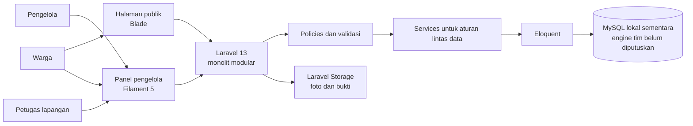
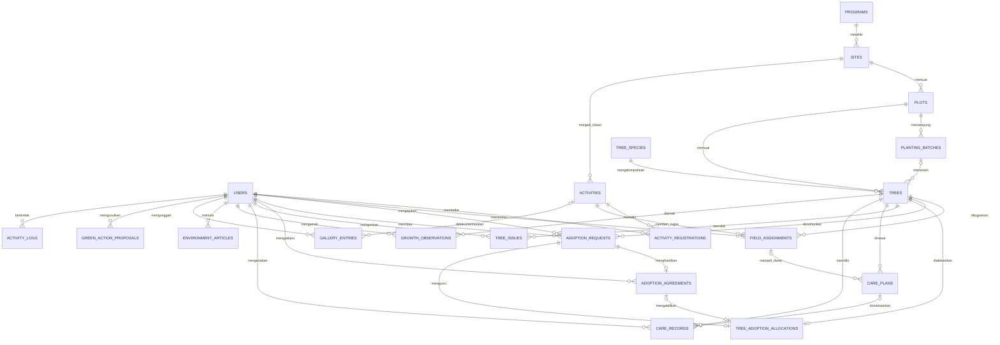

# Arsitektur Hijauku — rancangan rev1 untuk tinjauan

**Status: draf teknis untuk dibahas.** Dokumen ini merapikan rancangan awal menjadi dasar implementasi. Ia belum layak disebut final sampai roster anggota, engine basis data, backlog Jira, dan tampilan Stitch dikonfirmasi bersama.

## Tujuan produk

Hijauku mencatat program penghijauan beserta lokasi dan inventaris pohonnya, mendukung alur adopsi warga, mengatur kegiatan dan tugas lapangan, serta menyimpan bukti perawatan dan pertumbuhan. Informasi yang sudah ditinjau dapat diterbitkan untuk warga.

## Gambaran sistem

Satu aplikasi Laravel dipilih agar tim dapat berbagi model, validasi, autentikasi, dan deployment tanpa menambah layanan terpisah. Area domain dipisahkan melalui model, policy, service, migration, dan Filament Resource. Blade menyajikan laman publik. Filament menjadi panel internal di `/app`. Pemisahan modul berada di kode dan backlog; starter belum membuat modul sebagai paket/deployment terpisah.

### Alur request

1. Route atau Filament Resource menerima permintaan.
2. Autentikasi memastikan identitas pengguna.
3. Policy membatasi tindakan berdasarkan peran dan kepemilikan data.
4. Form request/validasi memastikan bentuk dan nilai input benar.
5. Service mengelola aturan lintas tabel, transisi status dan transaksi database.
6. Eloquent menyimpan data; Laravel Storage menyimpan foto dan bukti. Lokasi file disimpan di database, konten file tidak.
7. Query publik hanya mengambil data dengan status terbit/terverifikasi yang sesuai.

## Peran dan batas akses

| Peran | Kebutuhan utama |
| --- | --- |
| `manager` / Pengelola | Mengelola master program dan pohon; memutus permohonan/usulan; mengatur tugas; memverifikasi laporan dan mengelola publikasi. |
| `field_staff` / Petugas lapangan | Melihat kegiatan dan penugasan sendiri; mengirim realisasi, pengamatan, dan laporan masalah sesuai penugasan. |
| `citizen` / Warga | Membaca katalog yang dibuka; mengelola permohonan dan pendaftaran milik sendiri; mengirim laporan pohon yang diadopsi dan usulan aksi. |

Starter menyimpan role di enum `App\Enums\UserRole`. Filament saat ini hanya menolak akun tidak aktif; pembatasan peran per halaman dan aksi harus ditambahkan melalui policies serta konfigurasi Resource sebelum modul dibuka ke pengguna.

## Area domain

| Area | Modul | Aturan utama |
| --- | --- | --- |
| Program dan inventaris | M01–M06 | Lokasi masuk ke program; petak berada di lokasi; batch dan pohon terhubung ke petak; kode unik; kapasitas petak diperiksa saat transaksi. |
| Kegiatan | M07–M09 | Waktu akhir setelah waktu awal; kuota tidak terlampaui; pendaftaran unik per akun/kegiatan; petugas hanya menjalankan penugasan sendiri. |
| Adopsi | M10–M11 | Permohonan ditinjau sebelum kesepakatan; satu alokasi tertahan/aktif per pohon; persetujuan berjalan dalam transaksi. |
| Pemantauan | M12–M15 | Bukti dan laporan terkait pohon; pengirim tidak memverifikasi kiriman sendiri; hanya data terverifikasi masuk ke ringkasan publik. |
| Publikasi | M16–M17 | Draf tetap privat; foto tidak menjadi publik sebelum diterbitkan; galeri tidak menggantikan bukti perawatan. |
| Usulan warga | M18 | Usulan memiliki status dan keputusan; diterima tidak otomatis membuat kegiatan inti. |

## Hubungan skema

Diagram menampilkan semua tabel awal, termasuk tabel sistem Laravel dan tabel teknis. Kolom lengkap ada di migrasi; hubungan bisnis disederhanakan agar diagram mudah dibaca.

`ACTIVITY_LOGS` juga mempunyai `subject_type` dan `subject_id` polimorfik, sehingga tidak dapat digambarkan sebagai satu relasi foreign key biasa. Tabel default Laravel (`cache`, `jobs`, dan lainnya) tidak ditampilkan di diagram.

## Aturan integritas penting

- Satu pohon hanya punya satu baris `tree_adoption_allocations` selama sedang ditahan/diadopsi. Saat kesepakatan selesai, service menghapus baris lock dalam transaksi; `adoption_agreements` tetap menyimpan riwayat. Jika kelak perlu laporan historis alokasi, buat tabel riwayat terpisah.
- Saat menerima permohonan, service harus mengunci pohon/alokasi dalam transaksi untuk menolak dua persetujuan bersamaan. Constraint unik adalah lapis perlindungan tambahan, bukan satu-satunya validasi.
- Kunci unik `(batch_id, plot_id)` pada pohon mencegah pohon menunjuk batch pada petak lain.
- Indeks unik mencegah pendaftaran ganda, kode pohon ganda, kode petak berulang di lokasi, dan pengamatan ganda pada tanggal yang sama.
- Batas kapasitas, kuota, status, kepemilikan, nilai positif, dan larangan self-review perlu validasi aplikasi serta transaksi; migrasi saja belum menegakkannya.
- Bukti foto disimpan memakai disk privat. Rute unduh perlu memeriksa role dan kepemilikan.

> Catatan: penghapusan baris lock saat adopsi berakhir harus dilakukan oleh service dalam transaksi bersama perubahan status agreement. Jangan menghapus constraint unik pohon. Tambahkan riwayat alokasi terpisah bila tim membutuhkan jejak lock.

## Keputusan teknis sementara

| Keputusan | Pilihan starter | Alasan/status |
| --- | --- | --- |
| Backend | Laravel 13 monolit | Cocok dengan rancangan dan runtime PHP lokal. |
| Panel internal | Filament 5 pada `/app` | Mempercepat panel CRUD pengelola; akses final tetap harus dibatasi. |
| Publik | Blade + Vite | Laman publik dan katalog berada pada aplikasi yang sama. |
| Database pengembangan | MySQL di `.env.example` | Sementara, disesuaikan dengan driver Laragon yang ditemukan di mesin pemilik. Tim perlu memilih engine bersama. |
| CI | SQLite sementara | Menguji migrasi dan seeder tanpa layanan database di runner. Kompatibilitas MySQL/PostgreSQL tetap perlu diperiksa saat engine diputuskan. |
| Foto dan bukti | Laravel Storage privat | Database hanya menyimpan path; unggahan publik perlu alur eksplisit. |
| Bahasa/waktu | Locale Indonesia, `Asia/Jakarta` | Sesuai pengguna proyek. Simpan timestamp dengan konvensi konsisten. |
| UI | Placeholder | Belum dibaca dari Stitch karena sign-in Google diperlukan. |

### Yang belum termasuk

Starter belum membuat seluruh Filament Resource, policies, services, transaksi adopsi, validasi kuota/kapasitas, workflow verifikasi, dashboard, unggah privat, API, deployment, atau integrasi email. Masing-masing perlu menjadi story Jira dengan acceptance criteria.

## Panduan sebelum menyetujui rev1

1. Sahkan roster dan target 18 modul/54 PBI.
2. Cocokkan epics/stories dan sprint Jira dengan katalog requirement.
3. Setujui database bersama lalu perbarui konfigurasi dan CI.
4. Baca proyek Stitch dan petakan halaman ke peran serta route.
5. Setujui aturan adopsi ulang, retensi bukti, dan status transisi.
