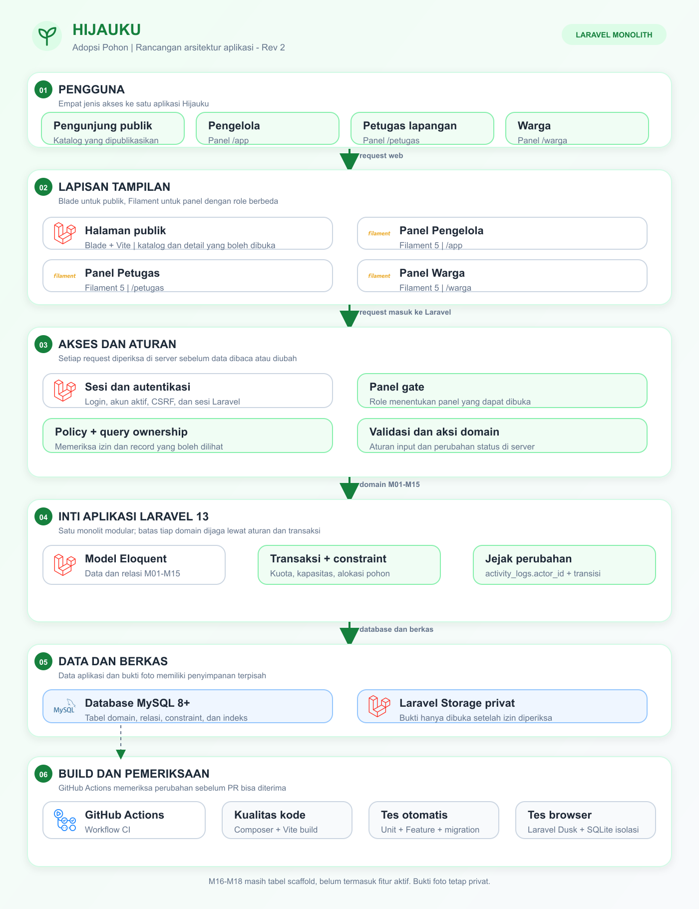

# Arsitektur Hijauku - Rev 2

**Status:** Baseline arsitektur aplikasi dan implementasi yang sudah masuk ke `main`, diperiksa 11 November 2026 setelah PR #19.
**Berlaku:** Scope aktif 15 modul, lima anggota, Laravel 13 + Filament 5.
**Pemilik keputusan proyek:** Yoga (PM). Perubahan berikutnya dicatat pada Jira dan pull request.

Dokumen ini menjelaskan sistem yang akan dibangun. Bagian “sudah tersedia” membedakan fondasi yang benar-benar ada dari fitur bisnis yang masih harus dikerjakan per PBI.

## 1. Tujuan dan batas produk

Hijauku membantu pengelola program penghijauan menjaga data program dan pohon, menyelenggarakan kegiatan lapangan, memproses adopsi, serta memantau perawatan dan pertumbuhan. Warga dapat membaca informasi yang dipublikasikan dan mengelola aktivitas miliknya. Petugas lapangan melihat penugasan dan mengirim laporan sesuai tugas.

Backlog aktif berisi 15 modul M01 sampai M15 dan 45 story HJK-001 sampai HJK-045. HAP-6 sudah dihapus permanen dari Jira atas keputusan PM. Modul M16 Artikel, M17 Galeri, dan M18 Usulan Aksi berada di luar scope aktif. Tabel/model terkait masih ada sebagai scaffold dari rancangan awal; tidak ada halaman, endpoint, atau workflow aktif untuk area tersebut.

## 2. Gambaran sistem

Pengguna publik membuka halaman Blade + Vite. Pengelola, Petugas, dan Warga memakai satu halaman masuk `/login`; setelah autentikasi, sistem mengarahkan mereka ke panel Filament sesuai role. Ketiga panel tetap terpisah di `/app`, `/petugas`, dan `/warga`. Satu aplikasi Laravel 13 dan satu database MySQL dipakai bersama; Eloquent mengakses data. Policy, query scope, validasi, dan service menjaga aturan akses serta proses bisnis. Foto dan bukti disimpan di Laravel Storage privat.

Alur request:

1. Route publik atau panel Filament menerima request.
2. Form `/login` memeriksa akun aktif dengan Laravel session guard, membatasi percobaan masuk, meregenerasi session setelah berhasil, lalu mengarahkan pengguna berdasarkan role. Request panel tanpa akun diarahkan kembali ke `/login`. Route publik hanya menyajikan field yang diizinkan untuk publik dan tidak mewajibkan login.
3. Untuk panel, User::canAccessPanel() hanya membuka panel yang cocok dengan role dan status aktif.
4. Policy memutuskan izin untuk aksi dan record. Query list juga dibatasi ke data yang boleh dilihat.
5. Validasi memeriksa input dan aturan lintas field.
6. Service menjalankan transisi bisnis yang memerlukan transaksi, misalnya kuota, kapasitas petak, alokasi pohon, dan verifikasi.
7. Eloquent menyimpan data. File bukti disimpan pada disk privat; database hanya menyimpan path.

## 3. Peran dan area akses

| Role | Panel | Batas akses dasar |
| --- | --- | --- |
| manager | /app | Mengelola master data, memutus permohonan, menyusun penugasan, dan memverifikasi kiriman. |
| field_staff | /petugas | Melihat penugasan milik sendiri dan mengirim laporan sesuai tanggung jawab. |
| citizen | /warga | Melihat dan mengelola pendaftaran/permohonan milik sendiri serta mengirim laporan. |

Panel gate bukan pengganti Policy. Model baru harus memiliki Policy sebelum Resource atau endpoint dibuat. viewAny mengizinkan role membuka daftar; ia tidak otomatis memfilter record. Query Resource harus menerapkan scope ownership yang sama.

### Policy dasar yang sudah dipasang

- Master data dan akun: pengelola saja.
- Program M01: hanya pengelola yang dapat membuat draf, mengaktifkan program yang datanya lengkap, atau mengarsipkan program berstatus selesai. Aktivasi dan pengarsipan memakai service transaksional serta mencatat aktor, alasan, waktu, dan perubahan status pada `activity_logs`. Arsip tidak menghapus lokasi atau pohon yang terkait.
- Penugasan: petugas boleh melihat penugasan dengan assignee_id miliknya; tidak dapat mengubah assignment.
- Pendaftaran kegiatan: warga dapat membuat dan melihat pendaftaran miliknya.
- Kehadiran M08 direncanakan untuk pengelola pada HAP-29. `ActivityRegistrationPolicy::viewAny()` pada scaffold masih membatasi daftar ke warga; implementasi HAP-29 harus menyesuaikan izin/query yang diperlukan dan menguji manager serta batas record. Panel manager saja tidak mengizinkan daftar secara otomatis.
- Permohonan adopsi: warga dapat membuat dan melihat miliknya; aksi review hanya pengelola dan pelaku tidak boleh meninjau permohonannya sendiri.
- Kesepakatan: warga hanya melihat miliknya; aksi accept hanya pemilik kesepakatan berstatus awaiting_acceptance.
- Laporan masalah: warga/petugas dapat membuat serta membaca laporannya sendiri.
- Rencana perawatan: petugas hanya dapat membaca rencana dari assignment miliknya.
- Realisasi dan pengamatan: petugas dapat membuat dan membaca kirimannya sendiri; verifikasi hanya pengelola yang bukan pengirim.

Aksi review, accept, dan verify adalah izin khusus. UI/service yang mengimplementasikannya tetap harus mengubah field yang tepat dan menolak perubahan field lain. HJK-002 dan HJK-003 berjalan melalui action Filament pada panel `/app` dan request Livewire; kedua story ini tidak menetapkan REST API terpisah. API baru perlu acceptance criteria dan dokumentasi tersendiri sebelum ditambahkan.

## 4. Modul aktif dan pembagian pemilik

| Epic | Area | Modul aktif | Penanggung jawab |
| --- | --- | --- | --- |
| HAP-1 | Fondasi dan infrastruktur | Sprint 0, autentikasi, CI, starter | Yoga / PM |
| HAP-2 | Data dasar dan inventaris | M01-M06 | Yoga (M01-M03), Rofii (M04-M06) |
| HAP-3 | Kegiatan dan penugasan | M07-M09 | Bitari |
| HAP-4 | Adopsi dan masalah pohon | M10-M12 | Arif |
| HAP-5 | Perawatan dan pengamatan | M13-M15 | Wira |

Setiap modul memiliki tiga story. Dengan tiga modul per anggota, pembagian sekarang menghasilkan sembilan story per orang. Daftar dan pembagian sprint ada di requirements.md.

## 5. Model data ringkas

Program memiliki lokasi; lokasi memiliki petak; petak menampung batch penanaman dan pohon; pohon memiliki jenis. Lokasi juga menjadi tempat kegiatan. Kegiatan memiliki pendaftaran dan penugasan. Pohon terkait dengan permohonan adopsi, kesepakatan/alokasi, laporan masalah, rencana perawatan, realisasi, dan pengamatan.

activity_logs memakai subject polimorfik sehingga tidak ditampilkan sebagai relasi foreign key pada ringkasan. Skema lengkap dan constraint dijelaskan di database.md.

## 6. Aturan integritas penting

- Satu pendaftaran per warga untuk satu kegiatan; kuota diperiksa di service dalam transaksi.
- Kapasitas petak diperiksa saat menambah batch/pohon, bukan hanya saat formulir dibuka.
- Alokasi pohon unik mencegah dua permohonan menahan pohon yang sama. Persetujuan mengunci record di dalam transaksi.
- Petugas hanya mengirim catatan untuk pohon yang terhubung dengan penugasan miliknya.
- Pengirim care record/growth observation tidak boleh memverifikasi kirimannya sendiri.
- Bukti foto privat sampai ada alur publikasi dan izin yang jelas.
- Perubahan status melalui aksi/service eksplisit; jangan menerima status final dari input bebas pengguna.

## 7. Keputusan teknologi

| Keputusan | Baseline Rev 1 |
| --- | --- |
| Aplikasi | Laravel 13, monolit modular |
| Panel | Filament 5; panel dipisah sesuai role |
| Halaman publik | Blade + Vite |
| Database pengembangan | MySQL 8+ dengan database khusus proyek |
| Tes cepat | SQLite in-memory |
| CI integrasi skema | MySQL 8 service dan SQLite |
| File bukti | Laravel Storage privat |
| Bahasa dan waktu | Bahasa Indonesia; Asia/Jakarta |

Rancangan awal mengusulkan PostgreSQL 18. Untuk starter Sprint 0, PM menetapkan MySQL sebagai baseline karena konfigurasi pengembangan lokal yang sudah berjalan dan starter telah memakai MySQL. Alasan dan dampaknya dicatat di adr/0001-database-engine.md. File .env lokal pengguna tidak diubah.

## 8. Yang sudah tersedia dan yang belum

**Sudah tersedia di `main`:** fondasi Laravel/Filament, tiga panel dan gate role, Policy dasar, model/migration awal, seeder demo, beranda publik, serta alur M01 untuk membuat draf, mengaktifkan program, dan mengarsipkan program selesai (HJK-001-HJK-003). M07 HJK-019 menyediakan pencatatan rencana kegiatan. M13 HJK-037 sampai HJK-039 menyediakan penyusunan rencana, prioritas, koreksi, dan pembatalan rencana dengan riwayat. Dokumentasi dan CI juga tersedia.

**Sudah tersedia di `main`:** HAP-10-HAP-12 / HJK-004-HJK-006 masuk melalui PR #20. Resource lokasi memakai `SitePolicy`, form dan tabel Filament reusable, serta action terpisah untuk membuat, mengubah, dan menghapus lokasi. Validasi dan otorisasi ada di server. Perubahan memakai transaksi dan audit log; relasi petak/kegiatan mencegah penghapusan lokasi yang masih dipakai. Schema `sites` dan foreign key sudah tersedia, sehingga story ini tidak memerlukan migration. Detail acuan Stitch dan batas kesetaraan UI ada di `docs/ui-design.md`.

**Belum diterima di `main`:** pekerjaan M04 HAP-16/17/18, M07 HAP-26/27, dan M10 HAP-34/35 masih perlu memenuhi acceptance dan tes masing-masing. PR #12, #14, dan #15 ditutup tanpa merge. Pemilik mempertahankan commit unik di branch personal, menyinkronkan `main`, meninjau temuan lama yang masih berlaku, lalu membuka PR pengganti untuk review dan CI baru. Cakupan HAP-18 perlu dipastikan dengan pemilik modul.

**Belum dianggap selesai:** story lain yang masih To Do, filter ownership untuk setiap Resource, workflow transaksi di modul yang belum diterima, upload bukti privat, dashboard berisi metrik, layar Stitch yang belum diimplementasikan, deployment, dan integrasi notifikasi. Pekerjaan ini masuk ke story M01-M15; fitur tidak dianggap selesai hanya karena tabel/model atau shell panel tersedia.

HJK-001 menambahkan alur pembuatan program pada panel manager. Program adalah master data yang bisa dilihat lintas pengelola, sementara `created_by` tetap mencatat siapa yang membuatnya. Status awal ditetapkan server sebagai `draft`; event pencatatan program disimpan bersama record dalam transaksi. HJK-002 hanya mengizinkan aktivasi dari status `draft` setelah nama, tujuan, dan periode lolos validasi. HJK-003 hanya mengizinkan pengarsipan status `completed`; record tetap tersimpan supaya relasi lokasi dan pohon aman. Kedua transisi mengambil aktor dari sesi, meminta alasan, dan menulis audit log dalam transaksi. Pengubahan data program dan penghapusan tetap tidak tersedia karena bukan acceptance story saat ini.

M01 memakai Resource Filament dan request Livewire. Tidak ada REST API terpisah untuk CRUD dalam acceptance HJK-001 sampai HJK-003. Tambahkan API hanya setelah requirement Jira menjelaskan pemakai, autentikasi, request/response, error, dan tesnya.

## 9. Perubahan arsitektur

Diagram proposal, koreksi acceptance/skema, serta sumber rancangan UI yang diselaraskan pada 25 Oktober 2026 dicatat di [audit proposal dan presentasi](proposal-audit.md). Naskah video menjelaskan rancangan; ia tidak menggantikan acceptance atau bukti pengujian.

Perubahan requirement atau keputusan harus menyertakan alasan, dampak data/role, migration bila perlu, dan acceptance criteria. Diskusikan perubahan lintas modul di Jira; dokumentasikan keputusan yang memengaruhi tim sebagai ADR di docs/adr/.
