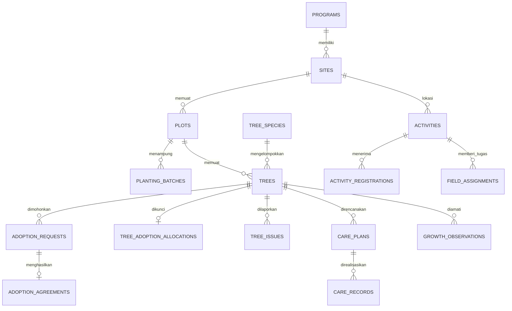

# Skema database Hijauku

Skema berada di migration Laravel dan ditujukan untuk MySQL 8+. File migration tidak mengubah database saat dibuat. Jalankan hanya pada database pengembangan yang sudah diperiksa di .env.

Migrasi domain membuat 20 tabel: 16 tabel untuk modul aktif M01-M15 (M11 menggunakan tabel agreement dan allocation), tiga tabel scaffold tertunda M16-M18, dan satu tabel activity_logs. Tabel akun dan infrastruktur Laravel dibuat pada migration terpisah.

## Tabel aktif

| Tabel | Isi dan relasi utama | Modul |
| --- | --- | --- |
| programs | Tujuan, periode, status; satu program memiliki lokasi | M01 |
| sites | Alamat/koordinat dalam program; memiliki petak dan kegiatan | M02 |
| plots | Petak dan kapasitas di lokasi | M03 |
| tree_species | Nama jenis dan catatan perawatan | M04 |
| planting_batches | Pelaksanaan penanaman pada petak | M05 |
| trees | Kode, jenis, petak, batch, tanggal tanam, kondisi | M06 |
| activities | Jadwal, lokasi, kuota, dan status | M07 |
| activity_registrations | Pendaftaran/kehadiran; unik per warga dan kegiatan | M08 |
| field_assignments | Kegiatan, pohon, petugas, tenggat, status | M09 |
| adoption_requests | Pohon, pemohon, alasan, keputusan dan reviewer | M10 |
| adoption_agreements | Syarat/periode satu permohonan yang disetujui | M11 |
| tree_adoption_allocations | Lock satu pohon untuk mencegah persetujuan bersamaan | M11 |
| tree_issues | Laporan masalah, bukti privat, prioritas, resolusi | M12 |
| care_plans | Rencana tindakan untuk pohon dan assignment | M13 |
| care_records | Realisasi, pelaksana, bukti, status dan verifikator | M14 |
| growth_observations | Ukuran/kondisi pohon, bukti dan verifikasi | M15 |

## Tabel yang masih disiapkan untuk scope tertunda

| Tabel | Isi | Status |
| --- | --- | --- |
| environment_articles | Artikel, penulis dan waktu publikasi | M16, di luar scope aktif |
| gallery_entries | Foto kegiatan dan pengunggah | M17, di luar scope aktif |
| green_action_proposals | Usulan warga dan keputusan | M18, di luar scope aktif |

Tabel tersebut tersisa dari rancangan 18 modul. HAP-6 sudah dihapus permanen dari Jira dan M16 sampai M18 tidak mempunyai story aktif. Jangan membuat Resource, route, atau workflow untuk tabel ini sampai PM menetapkan scope baru beserta acceptance criteria.

## Tabel teknis

- users menyimpan akun, enum role, dan status aktif. Password memakai cast hash Laravel.
- activity_logs menyimpan actor, aksi, transisi status, metadata, dan subject polimorfik.
- Migration Laravel menyiapkan tabel session, cache, queue, dan failed job sesuai konfigurasi proyek.

## Constraint yang sudah ada

- Primary/foreign key mencegah relasi orphan; penghapusan master yang masih dipakai dibatasi.
- Kode pohon unik global; kode petak unik di lokasi; kode batch unik di petak.
- Foreign key gabungan memastikan pohon dan batch berada pada petak yang sama.
- Pendaftaran unik pada kombinasi kegiatan dan warga.
- Satu agreement per permohonan dan satu allocation per pohon.
- Pengamatan unik untuk pohon pada tanggal yang sama.
- Indeks status/tanggal/owner disiapkan untuk query umum.

## Aturan yang harus ditegakkan oleh aplikasi

Constraint statis tidak cukup untuk memeriksa kuota, kapasitas petak, availability pohon, status yang sah, tanggal lintas record, ownership, ukuran positif, dan self-review. Gunakan:

1. validasi request untuk bentuk/nilai input;
2. Policy untuk role dan record;
3. query scope untuk membatasi daftar;
4. service + database transaction untuk operasi lintas record atau rawan race condition;
5. tes untuk kondisi diterima dan ditolak.

Setiap Resource Filament harus menyembunyikan field sensitif dan membatasi query, walaupun Policy viewAny mengizinkan role membuka daftar. Untuk upload bukti, gunakan disk privat, validasi tipe/ukuran, dan route download yang memanggil otorisasi.

## Database lokal dan CI

MySQL 8+ adalah baseline development tim. Lihat SQL setup lokal di database-setup.mysql.sql dan pastikan akun memiliki akses hanya ke database pengembangan. CI memeriksa migration/seeder pada MySQL dan SQLite; tes cepat memakai SQLite in-memory.

Jangan menimpa .env lokal yang sudah bekerja. Sebelum migrate, verifikasi DB_HOST, DB_DATABASE, DB_USERNAME, dan hak akses. Hindari migrate:fresh pada database yang mungkin berisi data yang ingin disimpan.
